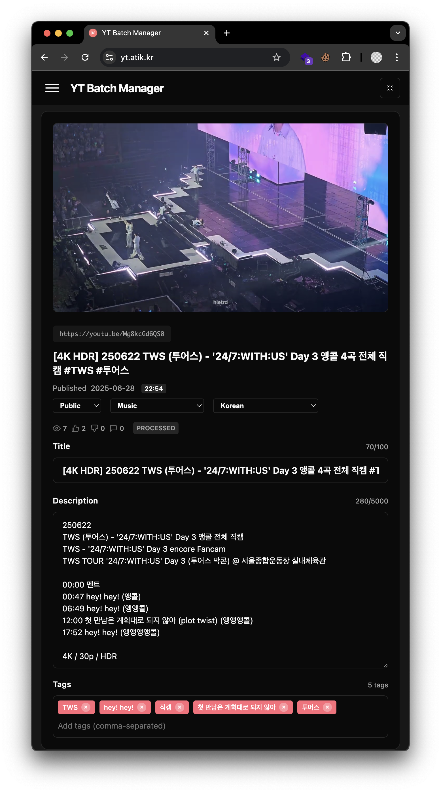
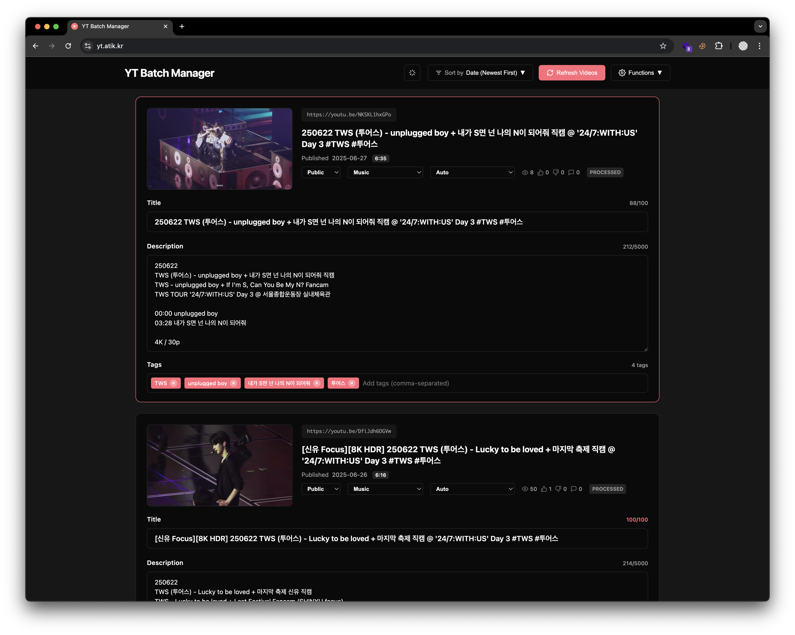
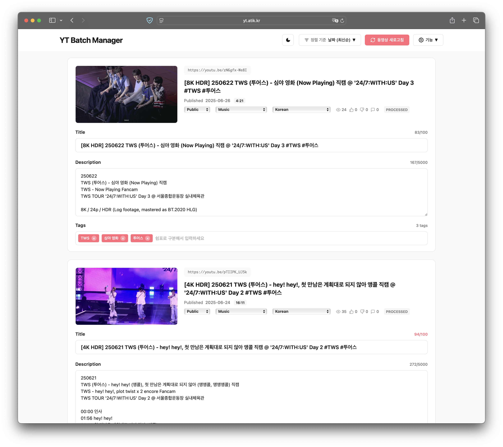

# YT Batch Manager Web







## [Go to the app](https://yt.atik.kr/)

* [Privacy Policy](https://yt.atik.kr/privacy.html)
* [Terms of Service](https://yt.atik.kr/terms.html)

## About

As both YouTube studio webpage and YT studio mobile app does not provide a convinient user experiences for batch editing video titles and descriptions, I had to make this app to manage titles and descriptions of my videos in a single place.

This is a web port of an [Electron port, as a standalone app](https://github.com/hletrd/yt-batch-manager), of [yt-batch-manager-py](https://github.com/hletrd/yt-batch-manager-py).

* Disclaimer: YouTube is a registered trademark of Google LLC, and this project is not affiliated with YouTube in any way.

## 설명

유튜브 채널의 영상 제목과 설명을 한 페이지에서 바로 수정하고 관리할 수 있는 앱입니다.

유튜브 채널에서 영상 제목과 설명을 한 번에 수정할 때 각 영상에 하나하나 들어가서 확인하고 수정해야 하는 게 너무 킹받아서 만들었습니다. 웹 페이지든 YT Studio 모바일 앱이든 왜 영상 제목과 설명을 한 번에 나열해서 수정할 수 있는 기능이 없는건지 모르겠습니다. 원래 [Python으로 만들었다가](https://github.com/hletrd/yt-batch-manager-py) 별도 데스크탑 앱이 편할 것 같아 [Electron으로 다시 만들었다가](https://github.com/hletrd/yt-batch-manager) 웹 페이지가 편한 것 같아 웹으로 다시 옮겼습니다.

---

## Features

* Edit video titles and descriptions in a single page, which YouTube does not allow.
  * YouTube forces a very user-unfriendly experiences, where you have to go to each video page to edit the title and description, and then save it.
* Bulk-edit privacy status, category, audio language, and tags as well.
* Set the recording date and recording location (latitude/longitude) per video, with a use-current-location button and a view-on-map link.
* Change the license (Standard YouTube License / Creative Commons) and the title/description language.
* Toggle the "altered or synthetic content" (AI) disclosure per video.
* Set whether a video can be embedded, whether its stats are public, and whether it is made for kids.
* Replace a video's custom thumbnail, or batch-replace many at once through a ZIP backup (see below).
* A scheduled video's publish time is kept when you edit it, and shown as a badge.
* Copy a video's tags to the clipboard with one click.
* Likely YouTube Shorts (vertical/square and 3 minutes or shorter) are flagged with a badge.
* Loads every video in the channel, not just the most recent ones.
* Save/load video data to/from local JSON files for offline editing and backup. Exports include every editable field (unset values as `null`) so the file doubles as a fill-in template; imported backups are validated and sanitized before anything is rendered or saved. A file may also list only the fields you want to change.
* Save/load a ZIP backup that also contains every video's thumbnail, to batch-replace thumbnails.
* Stays signed in across reloads — the session is restored automatically, so you don't have to log in again every hour.

## 기능 (한국어)

* 유튜브 채널의 영상 하나하나를 각각 열지 않아도 한 번에 영상 제목과 설명을 편집할 수 있습니다.
  * 이거 유튜브 Studio 웹페이지나 YT Studio 앱에서는 안 됩니다. 대체 왜 안 되는지 모르겠습니다.
* 영상 제목과 설명을 JSON으로 저장하고 불러올 수 있습니다. 내보낸 JSON에는 모든 편집 가능 항목이 포함되며(미설정 값은 `null`), 불러온 백업은 렌더링·저장 전에 검증/정제됩니다. 바꿀 항목만 적은 JSON도 불러올 수 있습니다.
* 썸네일까지 담은 ZIP으로 저장하고 불러올 수 있어, 여러 영상의 썸네일을 한 번에 바꿀 수 있습니다.
* 영상 공개 설정 / 카테고리 / 언어 / 태그 등도 한 번에 편집할 수 있습니다.
* 영상별 촬영일과 촬영 장소(위도/경도)를 설정할 수 있습니다. 현재 위치 버튼과 지도에서 보기 링크도 제공됩니다.
* 라이선스(표준 YouTube / 크리에이티브 커먼즈)와 제목·설명 언어를 변경할 수 있습니다.
* 영상별로 '변경되거나 합성된 콘텐츠(AI)' 공개 여부를 설정할 수 있습니다.
* 퍼가기 허용, 통계 공개, 아동용 여부를 설정할 수 있습니다.
* 예약 공개 영상을 수정해도 예약 시각이 유지되며, 배지로 표시됩니다.
* 버튼 한 번으로 영상의 태그를 클립보드에 복사할 수 있습니다.
* 쇼츠로 추정되는 영상(세로/정사각형이면서 3분 이하)에는 배지가 표시됩니다.
* 최근 영상만이 아니라 채널의 모든 영상을 불러옵니다.
* 새로고침하거나 다시 접속해도 로그인이 유지되어, 한 시간마다 다시 로그인할 필요가 없습니다.

---

## Batch editing with JSON / ZIP

**Functions → Save as JSON** writes one record per video. Edit the file, load it
back with **Functions → Load from file**, review the highlighted cards, and press
**Save All**. Only videos that differ from what is on YouTube are marked.

| Field | Notes |
| --- | --- |
| `id` | Video id. Required; records with an invalid id are ignored. |
| `title`, `description`, `tags` | `tags` is an array, or a comma-separated string. |
| `privacy_status` | `private`, `unlisted` or `public`. |
| `publish_at` | Scheduled publish time (ISO 8601), private videos only; `null` cancels the schedule. |
| `category_id`, `defaultAudioLanguage`, `default_language` | Category id and BCP-47 language codes. A language cannot be unset once set (a YouTube limitation). |
| `license` | `youtube` or `creativeCommon`. |
| `embeddable`, `public_stats_viewable`, `made_for_kids`, `contains_synthetic_media` | `true` / `false`. `made_for_kids` is written as your self-declaration, only when you change it; YouTube can still override it. |
| `recording_date`, `latitude`, `longitude` | `YYYY-MM-DD` and decimal degrees; `null` clears them. |
| `published_at` | Read-only (YouTube does not allow changing it). |

A record does not need every field: anything you leave out (or set to an invalid
value) keeps the current YouTube value, so `[{"id": "…", "title": "New title"}]`
changes just that title. Load your videos from YouTube first so the app knows
the current values.

**Thumbnails: Functions → Save as ZIP (with thumbnails)** exports the same JSON
as `videos.json` plus `thumbnails/<video id>.jpg|png` (the current thumbnail, at
most 1280×720) and a short `README.txt`. To replace thumbnails, overwrite images
in `thumbnails/` with new JPEG or PNG files (up to 50 MB; keep the video id as
the file name), re-zip, and load the ZIP. Only images you actually changed
are uploaded: an image is skipped if it is byte-identical to the exported copy
(`thumbnail_sha256`) or if it *looks* the same as the thumbnail YouTube shows
now. The visual check matters because YouTube re-encodes every thumbnail, so
your own original of an unchanged image (or a re-saved copy, or a ZIP you put
together yourself without hashes) never matches byte for byte; it still
notices small edits such as one changed digit in the text. It compares against
YouTube's 1280×720 (or 640×480) thumbnail and uses no API quota; a video that
has neither size gets its changed file uploaded. They show up as *New thumbnail · unsaved* (with a button
to discard) and are uploaded when you save. A video whose only change is the
thumbnail skips the metadata update. Notes:

* Custom thumbnails require a [verified channel](https://www.youtube.com/verify);
  otherwise the upload fails with `403`.
* Each thumbnail upload costs about 50 units of the 10,000-unit daily quota, and
  YouTube limits how many thumbnails a channel can upload per day
  (`uploadRateLimitExceeded`).
* Pending thumbnails are kept in memory only: save them before reloading
  (unless a save is cut short by the quota — see below).

### When the API quota runs out mid-save

**Save All** stops at the first `quotaExceeded` instead of failing every
remaining video. What was saved stays saved (and is written to the local cache,
so a reload shows it even while the quota is exhausted). Everything still
unsaved — form edits and pending thumbnails — is kept in this browser
(IndexedDB), and a notice tells you how many videos were saved and when the
quota resets (midnight Pacific Time, shown in your local time). You can close
the tab: the next time the videos load, the app offers to **Restore** the kept
changes; then press **Save All** again. If YouTube's thumbnail upload limit is
hit instead, metadata keeps saving and only the thumbnails are kept for later.
Logging out discards kept changes.

Every API request uses quota — even one that fails. So if the first 3 videos of
a Save All fail for the same reason (say, a channel that may not set custom
thumbnails), the rest are not sent: the remaining thumbnails stay pending while
other changes keep saving, or, for a failing metadata update, the batch stops.
Whenever a Save All does not fully succeed, a notice lists exactly what reached
YouTube: fully saved, details saved but thumbnail still pending, nothing saved,
and not attempted, with the error reasons and how often each occurred.

## Guide for developers

### Prerequisites

* Node.js 24 LTS installed (the project builds on Node 24).
* Google Cloud Console project with YouTube Data API v3 enabled.
* Your own YouTube channel.

### Setup

#### Install dependencies

```bash
$ npm install
```

#### Google API setup

##### Create a new project
1. Go to [Google Cloud Console](https://console.cloud.google.com/)
2. Create a new project, name it whatever you want.
3. Search for the **YouTube Data API v3** in the search bar, and enable it.
4. Search for the **OAuth consent screen** in the search bar, and navigate into it.
5. Click 'Get started'. Fill in the app name as whatever you want and user support email as your email address. Set audience to 'External'. Input your email addreess in 'Contact information'. Agree to the usage policy, and tap 'Create'.
6. click 'Clients' on the left sidebar.
7. Create a new client app as a web app, name it whatever you want.
   * **Important:** restrict the client's **Authorized JavaScript origins** and **Authorized redirect URIs** to the exact domain where you deploy the app (e.g. `https://your-domain.example`). Because this is a browser-only app, the OAuth `client_secret` ships to the client; locking the origins/redirect URIs is what keeps that secret from being usable elsewhere (PKCE is also enforced by the app).
8. Download the credentials JSON file, and rename it to `credentials.json`. Put it in the directory `src/`.

##### Add scopes
1. Search for the **OAuth consent screen** in the search bar, and click 'Data Access' on the left sidebar.
2. Click 'Add or remove scopes' and enter the following scope in **Manually add scopes** text box:
```
https://www.googleapis.com/auth/youtube.force-ssl
```
3. Click 'Add to table'.
4. Click 'Update'.
5. Click 'Save'.

##### Add yourself as a test user
1. Search for the **OAuth consent screen** in the search bar, and click 'Audience' on the left sidebar.
2. Click 'Add user' under 'Test users' and enter your email address.

#### Run the application (for development)

```bash
npm run dev
```

The application will launch and prompt for Google OAuth authentication on first run.

#### Build, lint, and type-check

```bash
npm run build          # tsc -p tsconfig.json + copy static assets + generate docs
npm run lint           # eslint over src/**/*.ts
npx tsc -p tsconfig.json   # type-check only
```

There is no bundler: TypeScript compiles to native browser ES modules
(`<script type="module">` with `.js`-extension imports), and `dist/` is served
as-is. Pushing to `master` auto-deploys to GitHub Pages via
`.github/workflows/deploy.yml`.

#### End-to-end tests

`e2e/` contains Playwright flow tests that run against a fully mocked
Google/YouTube backend, so **no real credentials or quota are needed**. They
cover the OAuth + PKCE handshake, token exchange, the video-load chain,
rendering, the `videos.update` request bodies, 401 silent-refresh-retry, cache
reload, quota-403 messaging, logout, and (in `batch-fields.mjs`) JSON/ZIP batch
edits, thumbnail uploads and the status fields that must be round-tripped. The
ZIP tests shell out to `zip`/`unzip`.

```bash
npm run build
npx http-server dist -p 8753 -c-1 &     # serve the build
npx http-server dist -p 8754 -c-1 &     # second port for the focused regression test
npx http-server dist -p 8755 -c-1 &     # third port for the batch-fields suite
cd e2e && npm init -y && npm i playwright
node e2e.mjs                 # full flow suite (port 8753)
node regression-language.mjs # focused: empty language codes are omitted (port 8754)
node batch-fields.mjs        # focused: JSON/ZIP batch edits and status round-trips (port 8755)
```

#### Source layout

The UI logic lives in small single-purpose ES modules orchestrated by
`src/app.ts` (the `YouTubeBatchManager` facade exposed as `window.app`, which
the rendered inline handlers call):

| Module | Responsibility |
| --- | --- |
| `youtube-api.ts` | All YouTube Data API calls, OAuth/PKCE, token storage & refresh |
| `app.ts` | Orchestrator/facade; wires the modules and owns app state |
| `video-card.ts` | Per-video card HTML template and option/image generators |
| `video-form.ts` | Reads a card's form into the `videos.update` payload |
| `tags.ts` | Tag chips: render, add/remove, copy |
| `temp-changes.ts` | Persist/restore unsaved edits across the OAuth redirect |
| `video-cache.ts` | `localStorage` video cache (save/load/validate/clear) |
| `backup.ts` | JSON export field filter + import validation/sanitization |
| `backup-zip.ts` | ZIP backup: thumbnails export, changed-thumbnail detection on import |
| `header-ui.ts`, `global-events.ts`, `ui-feedback.ts`, `theme.ts` | Header/menu, delegated events, toasts/overlays, theme toggle |
| `textarea-resize.ts`, `fallback-data.ts` | rAF-throttled auto-resize; offline category/language fallbacks |
| `utils/format.ts`, `utils/html.ts` | Duration/number formatting & Shorts heuristic; HTML/attribute escaping |
| `utils/zip.ts` | Dependency-free ZIP reader/writer (STORE/DEFLATE via `CompressionStream`) |
| `unsaved-changes.ts` | IndexedDB store for changes left unsaved by an exhausted quota |
| `i18n/` | English/Korean strings and the runtime renderer |

See [`AGENTS.md`](./AGENTS.md) for the architecture notes and the YouTube Data
API gotchas this app has to work around, and [`CHANGELOG.md`](./CHANGELOG.md)
for the list of notable changes.

---

## Troubleshooting

### Google OAuth authentication fails
1. Remove the stored credentials by clicking the "Remove Saved Credentials" button and reload the file.
2. If the problem persists, try to re-create the `credentials.json` file.

### "403 Forbidden" / quota exceeded when loading videos
The YouTube Data API has a default quota of 10,000 units/day per Google Cloud project — shared by everyone using the same deployment. The app lists your uploads efficiently (about 9 units per full load), but each saved video costs 50 units and each thumbnail upload about 50 more, so a large batch can use it up (see *When the API quota runs out mid-save* above). If you do see a `403 quotaExceeded`, the daily quota resets at midnight Pacific Time, or you can request a higher quota in the Google Cloud Console.

### Thumbnail upload fails with "403 Forbidden"
Custom thumbnails are only available to [verified channels](https://www.youtube.com/verify).
If you upload many thumbnails in a day, YouTube may also answer
`uploadRateLimitExceeded`; try again later.

### Recording date or location doesn't appear in YouTube Studio
YouTube has **deprecated the recording-location latitude/longitude** fields:
`videos.update` still accepts them without error, but they may not surface in
Studio. The recording **date** is applied. This is a YouTube API limitation, not
an app bug.

### Saving a video doesn't change anything (or used to error)
`videos.update` replaces a whole part and **deletes any property omitted from
the request**, and it rejects empty values for some fields (e.g. an empty
language code returns a deceptive `400 "Request metadata is invalid"`). The app
works around these by round-tripping the existing status fields, only sending
`recordingDetails` when the date/location actually changed, and omitting empty
language codes. If you hit a save error, capture the request body and check it
against these rules — `AGENTS.md` documents them.
